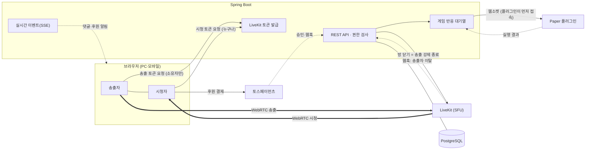

# BLOCKCAST (가칭)

PC 화면 공유와 휴대폰 카메라로 라이브 방송을 하고 보는 웹 서비스입니다.
**마인크래프트 스트리머 서버**와 후원을 연동해서, 시청자가 후원하면 서버장이 정해 둔 규칙대로 게임 안에서 바로 반응(음식 지급, 랜덤박스, 즉사 등)이 실행됩니다.

> 🚧 개발 중 · 공모전 제출 마감 2026-11-19 23:59

| 항목 | 내용 |
|---|---|
| 서비스 주소 | _배포 후 기재 예정_ |
| 시연 영상 | _촬영 후 기재 예정_ |
| 테스트 로그인 | 로그인 화면의 **"테스트 계정으로 바로 로그인"** 버튼 (비밀번호 입력 없음) |

## 테스트 계정

| 계정 | 역할 | 확인할 수 있는 것 |
|---|---|---|
| `streamer1` | 방송 소유자 · 마크 서버장 | 방송 등록·송출·수정·삭제, 서버 연동, 후원 규칙 |
| `streamer2` | 다른 스트리머 | `streamer1` 방송 수정·삭제·송출 시도 → **403 거절** |
| `viewer1` | 시청자 · 후원자 | 시청, 댓글, 테스트 결제 후원 |

비밀번호로 로그인하려면 환경변수 `TEST_ACCOUNT_PASSWORD` 값(기본 `test1234!`)을 쓰면 됩니다. 비로그인 상태로도 방송 목록·시청·다시보기가 됩니다.

## 기술 스택

| 영역 | 사용 기술 |
|---|---|
| 백엔드 | Spring Boot 4.1 · Java 21 · Spring Security · JPA · WebSocket · SSE |
| DB | PostgreSQL 17 (테스트는 H2) |
| 스트리밍 | LiveKit (WebRTC SFU) · 로컬은 Docker 개발 서버, 운영은 LiveKit Cloud |
| 프론트엔드 | React 19 · Vite 7 · TypeScript · livekit-client |
| 결제 | 토스페이먼츠 테스트 모드 |
| 마크 연동 | Paper 1.21 플러그인 (Java 21, 웹소켓) |

## 구조



- **송출 권한은 토큰으로 강제**: LiveKit 접속 토큰은 Spring 서버만 만들 수 있고, 방송 소유자에게만 `canPublish: true` 토큰을 줍니다. 시청자 토큰은 송출 권한이 없습니다.
- **방송 상태**: `READY → LIVE → ENDED` 한 방향. 종료하면 서버가 LiveKit 방을 닫아 송출이 끊깁니다. 송출자가 탭을 닫으면 LiveKit 웹훅 + 30초 유예 후 자동 종료합니다.
- **녹화**: 송출자 브라우저가 MediaRecorder로 녹화해 4초 조각으로 업로드하고, 서버가 순서 번호로 이어 붙입니다 (LiveKit Cloud 무료 녹화 한도 월 60분을 쓰지 않음).

## 실행 방법 (로컬)

**필요한 것**: Docker, JDK 21, Node.js 22

```bash
# 1. PostgreSQL(5433) + LiveKit 개발 서버(7880) 실행
docker compose up -d

# 2. 백엔드 (http://localhost:8080)
cd backend
./gradlew bootRun

# 3. 프론트엔드 (http://localhost:5173)
cd frontend
npm install
npm run dev
```

- 환경변수 예시: [`backend/.env.example`](backend/.env.example), [`frontend/.env.example`](frontend/.env.example). 값이 없으면 로컬 기본값으로 동작합니다.
- 후원 결제를 해 보려면 토스페이먼츠 개발자센터의 **테스트 키**를 `TOSS_CLIENT_KEY`, `TOSS_SECRET_KEY`로 넣어 주세요. 테스트 키는 실제 돈이 나가지 않습니다.
- 테스트: `cd backend && ./gradlew test`

## 기능 확인 방법

### PC 방송 (화면 + 탭/시스템 소리 + 마이크)

1. `streamer1`로 로그인 → **방송하기** → 제목 입력 → 송출 화면으로 이동
2. **PC 화면 공유** 선택, "마이크 함께 송출" 체크 → **방송 시작**
3. 공유 창에서 크롬 **탭**을 고르고 "탭 오디오도 공유"를 켜거나, 윈도우에서 **전체 화면** + "시스템 오디오 공유"를 켭니다
4. 다른 기기(또는 시크릿 창)에서 방송 목록 → 방송 선택 → 시청 (처음 한 번 **소리 켜기** 버튼)
5. 송출 화면에서 **방송 종료** → 시청 화면이 "방송 중이 아니에요"로 바뀌고 송출이 끊깁니다

### 모바일 방송 (카메라 + 마이크)

1. 휴대폰 브라우저에서 HTTPS 서비스 주소로 접속 → 로그인 → 방송하기
2. **카메라** 선택 (전면/후면) → **방송 시작** → 카메라·마이크 권한 허용
3. PC에서 같은 방송을 열어 시청 → 휴대폰에서 **방송 종료**

> 휴대폰 카메라는 브라우저 정책상 **HTTPS**에서만 켜집니다. 로컬에서 휴대폰으로 테스트하려면 배포 주소나 HTTPS 터널을 써 주세요.

### 지원 환경

| 기능 | 지원 |
|---|---|
| PC 화면 송출 | Chrome · Edge (최신). 탭 소리: Chrome/Edge 탭 공유, 시스템 소리: Windows 전체 화면 공유 |
| 모바일 송출 | Android Chrome, iOS Safari (iOS는 화면 공유 미지원 → 카메라만) |
| 시청 | 최신 Chrome · Edge · Safari · Firefox (PC·모바일) |
| 녹화 | MediaRecorder 지원 브라우저 (Chrome·Edge·Safari). WebM 녹화본은 일부 iOS에서 재생 제한 |

### 권한 확인 (비로그인 · 소유자 · 다른 사용자)

| 동작 | 비로그인 | 방송 소유자 | 다른 사용자 |
|---|---|---|---|
| 방송 목록·상세·시청 | ✅ | ✅ | ✅ |
| 방송 등록 | ❌ 401 | ✅ | ✅ |
| 방송 수정·삭제·송출·종료 | ❌ 401 | ✅ | ❌ 403 |
| 댓글 작성 | ❌ 401 | ✅ | ✅ |
| 댓글 수정·삭제 | ❌ 401 | 작성자만 ✅ | 작성자 아니면 ❌ 403 |
| 후원 | ❌ 401 | ❌ 자기 방송 불가 | ✅ |

자동 테스트: [`AccessControlTest`](backend/src/test/java/com/livecraft/AccessControlTest.java)

### 마크 서버 후원 연동

1. 서버장(`streamer1`) → **마크 서버** → 서버 등록 → 연동 코드 확인
2. Paper 1.21 서버의 `plugins/`에 플러그인을 넣고 실행 (빌드: `cd plugin && ./gradlew build` → `plugin/build/libs/BlockcastPlugin.jar`). `plugins/Blockcast/config.yml`의 `server-url`을 백엔드 주소로 맞춥니다
3. 게임에서 `/blockcast link <코드>` → 대시보드에 "플러그인 연결됨"
4. 화이트리스트에 **마크 닉네임 + 초대할 플랫폼 아이디**를 넣고, 스트리머가 **받은 초대 → 수락**
5. 후원 규칙 추가 (예: 1,000원 이상 = 음식, 30,000원 = 랜덤박스, 1,000,000원 = 즉사, 쿨타임 초)
6. 시청자가 후원 → 게임 안에서 반응 실행 → 방송 화면에 알림, 대시보드에 실행 결과

- 대상 플레이어가 오프라인이거나 플러그인 연결이 끊기면 **후원 자체를 막습니다** (결제 승인 직전에도 한 번 더 확인).
- 쿨타임 중 들어온 후원은 대기열에 쌓였다가 순서대로 실행되고, 후원 화면에 "대기 N건, 약 M초 후"를 보여 줍니다.

## 요구사항 근거 (코드 위치)

| 요구사항 | 구현 위치 |
|---|---|
| PC 화면 캡처 송출, 탭/시스템 소리 + 마이크 | [`StudioPage.tsx`](frontend/src/pages/StudioPage.tsx) `acquireTracks` |
| 모바일 카메라 + 마이크 송출 | [`StudioPage.tsx`](frontend/src/pages/StudioPage.tsx) `acquireTracks` (CAMERA) |
| 송출 시작·종료 시 연결 생성·종료 | [`StudioPage.tsx`](frontend/src/pages/StudioPage.tsx) `start`/`stop`, [`BroadcastService`](backend/src/main/java/com/livecraft/broadcast/BroadcastService.java) `startPublishing`/`end`, [`LiveKitService`](backend/src/main/java/com/livecraft/livekit/LiveKitService.java) `deleteRoom` |
| 방송 등록·조회·수정·삭제 | [`BroadcastController`](backend/src/main/java/com/livecraft/broadcast/BroadcastController.java) |
| 목록·상세·다른 기기 시청 | [`HomePage.tsx`](frontend/src/pages/HomePage.tsx), [`WatchPage.tsx`](frontend/src/pages/WatchPage.tsx), [`LiveViewer.tsx`](frontend/src/components/LiveViewer.tsx) |
| 방송 중/종료 상태 관리, 종료 시 송출 중단 | [`Broadcast`](backend/src/main/java/com/livecraft/broadcast/Broadcast.java), `BroadcastService.endAbandoned`, [`LiveKitWebhookController`](backend/src/main/java/com/livecraft/livekit/LiveKitWebhookController.java) |
| 영구 저장 (재시작 후 조회) | PostgreSQL + JPA 엔티티 |
| 회원가입·로그인·로그아웃·인증 상태 | [`AuthController`](backend/src/main/java/com/livecraft/auth/AuthController.java), [`TokenAuthenticationFilter`](backend/src/main/java/com/livecraft/auth/TokenAuthenticationFilter.java) (DB 세션 토큰, 로그아웃 시 즉시 무효) |
| 비로그인 조회·시청, 로그인 사용자만 등록·송출 | [`SecurityConfig`](backend/src/main/java/com/livecraft/global/SecurityConfig.java) |
| 수정·삭제·송출 제어 시 소유자 검증 | `BroadcastService.findOwned` |
| 댓글 CRUD, 작성자 검증 | [`CommentService`](backend/src/main/java/com/livecraft/comment/CommentService.java) `findWritten` |
| 후원 대상·금액 선택, 테스트 결제 | [`DonationPanel.tsx`](frontend/src/components/DonationPanel.tsx), [`DonationService`](backend/src/main/java/com/livecraft/donation/DonationService.java) `prepare` |
| 승인 결과·금액·대상 서버 검증 | `DonationService.confirm`, `finalizePaid` |
| 중복 승인 통지 방지, 방송별 내역·합계 | `DonationService.finalizePaid` (행 잠금 + `orderId`/`paymentKey` UNIQUE), `list` · 테스트 [`DonationAndGameActionTest`](backend/src/test/java/com/livecraft/donation/DonationAndGameActionTest.java) |
| 녹화 저장 | [`recorder.ts`](frontend/src/components/recorder.ts), [`RecordingService`](backend/src/main/java/com/livecraft/recording/RecordingService.java) |
| 녹화 목록·상세·재생 | [`RecordingsPage.tsx`](frontend/src/pages/RecordingsPage.tsx), [`RecordingDetailPage.tsx`](frontend/src/pages/RecordingDetailPage.tsx), `RecordingController.video` (Range 지원) |
| 영상 정보·저장 위치 영구 저장 | [`Recording`](backend/src/main/java/com/livecraft/recording/Recording.java) (`filePath`, 크기, 시각) |

## 오픈소스 · 참고

- [LiveKit](https://github.com/livekit/livekit) (Apache 2.0) · [livekit-client](https://github.com/livekit/client-sdk-js)
- [Paper API](https://papermc.io/) · [토스페이먼츠 SDK](https://docs.tosspayments.com/)
- 참고 글: [WebRTC를 직접 안 하고 LiveKit을 쓰는 이유 (xeunnie)](https://xeunnie.tistory.com/entry/LiveKit-1-WebRTC%EB%A5%BC-%EC%A7%81%EC%A0%91-%EC%95%88-%ED%95%98%EA%B3%A0-LiveKit%EC%9D%84-%EC%93%B0%EB%8A%94-%EC%9D%B4%EC%9C%A0)

## AI 활용

Claude Code로 기획 인터뷰, 기술 조사(웹 검색), 설계(system-design-skills), 구현·테스트를 진행했습니다. 상세 기록은 정리 후 공개 예정입니다.
